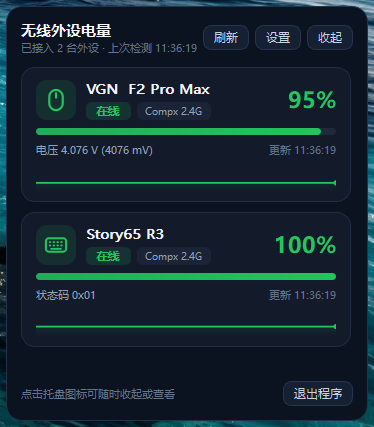
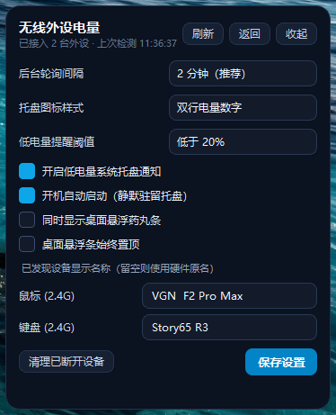

# 无线外设电量监控（Windows 托盘版）

一款轻量级、免安装的 Windows 桌面托盘工具，用于实时查看多品牌 2.4G 与蓝牙无线键鼠电量，无需开启各品牌臃肿的官方驱动软件。

## 已兼容外设生态（自动发现，插上即用）

1. **国产 Compx / CX 2.4G 全系方案**（`VID=0x3554 / 0x373B / 0x373E`，自动通配 `FF02:0002` 私有接口）
   - 涵盖常见国产无线鼠标与三模机械键盘：VGN、VXE、ATK、迈从 MCHOSE、狼蛛 AULA、Story65、LEOBOG、黑爵 Ajazz、Zaopin、Lamzu 等。
2. **罗技（Logitech）HID++ 2.0 无线外设**（`VID=0x046D`）
   - 支持 Lightspeed、Unifying 优联、Logi Bolt 接收器及多通道槽位（自动解析 `0x1004` Unified Battery、`0x1000` Battery Status、`0x1001` Battery Voltage）。
3. **雷蛇（Razer）2.4G 无线外设**（`VID=0x1532`）
   - 通过标准 90 字节 HID Feature Report 协议查询无线鼠标/键盘电量与充电状态。
4. **全品牌 Windows 蓝牙外设（BLE GATT Battery）**
   - 直接读取 Windows 原生蓝牙电池属性，支持 Keychron、NuPhy、Apple、微软、小米、罗技蓝牙、雷蛇蓝牙等几乎所有支持电量上报的蓝牙键鼠。

## 核心特性

- **右下角托盘驻留**：动态矢量双行数字/双进度条图标，鼠标悬停查看全设备摘要。
- **左键单击弹出面板**：点击托盘图标在右下角弹出暗色圆角面板（支持多设备滚动展示）并立刻刷新一次最新电量，失焦自动收起。
- **休眠缓存保护**：2.4G 外设进入休眠时不归零，保留上次有效电量并标注「休眠 · 上次记录」。
- **低电量防抖提醒 & 开机自启 & 可选桌面悬浮条**。
- **绿色便携**：打包为单文件 `dist\WirelessBatteryMonitor.exe` 后可直接发给其他 Windows 10/11 电脑免安装运行。

## 启动与打包

### 直接运行
- 双击 `dist\WirelessBatteryMonitor.exe`（绿色单文件，推荐），或双击源码目录下的 `run.pyw` / `start_silent.vbs`。

### 命令行与自检
```powershell
# 运行全部单元测试
python -m unittest discover -s E:\Workspace\wireless-battery\tests -v

# 运行端到端自检（检测 UI 与真实外设发现轮询）
python E:\Workspace\wireless-battery\run.py --smoke-test
```

### 重新打包单文件 `.exe`
双击 `build_exe.bat` 即可生成 `dist\WirelessBatteryMonitor.exe`。


## 效果展示



支持多种设置




悬浮球效果


